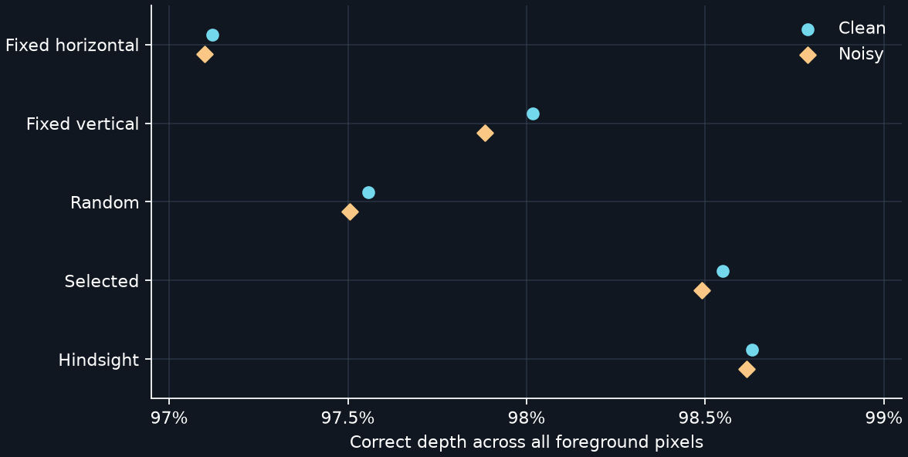

# A reference image could choose a better stereo camera direction before acquisition

A patch-repetition score from the first image selected the direction of one translated camera. Across 16,384 synthetic layouts, it beat the best fixed direction by **0.53 percentage points in clean images** and **0.61 in noisy images**. The same rule beat random selection by about one point. All methods had the same two photographs available for matching.

Each reference contained four textured surfaces, with either one or three repeating horizontally and the rest repeating vertically. Four cyclic depth assignments kept the reference identical and changed each surface's disparity. The direction selector saw that reference alone. For every eligible 3×3 patch, it finds the closest comparison at a shift of one, two or three pixels in either sign of a proposed direction. The selector takes the 20th percentile of these closest-match distances over the image and chooses the direction with the larger value. It has no true depth, visibility mask, or translated image. Fixed and randomly selected cameras receive an equal unit axis displacement and use the same calibrated 3×3 matching rule. [Registered protocol](PLAN.md) · [Implementation](run.py) · [Earlier orthogonal-camera result](../orthogonal/README.md)

| Panel | Layouts | Best fixed direction | Selected direction | Hindsight direction |
|---|---:|---:|---:|---:|
| Clean | 8,192 | 98.02% | 98.55% | 98.63% |
| Noisy | 8,192 | 97.88% | 98.49% | 98.62% |

The planned direction gained 0.532 percentage points over the fixed vertical camera on the clean panel, with a paired 95% interval of 0.508 to 0.556 points. The gain was 0.606 points on the noisy panel, with an interval of 0.576 to 0.635. On those panels it selected a vertical camera in 4,297 and 4,430 layouts. Hindsight chooses the better direction after inspecting true depth across each layout's four worlds and quantifies headroom. The planner's advantage survives Gaussian noise at standard deviation 0.025. The protocol uses synthetic axis-aligned periodic textures and calibrated discrete depths. The result measures one-image acquisition planning under this image model. [Counts and receipt](results) · [Independent verifier](verify.py) · [Audited bootstrap](audit.json)

The NumPy experiment ran on the owner's Apple M5 Ultra. The account owner proposed studying what geometric information can be recovered from images. OpenAI Codex designed and ran the test, verified the evidence and assisted with writing. Related work estimates depth from several fixed baselines or selects a subsequent observation using predictive uncertainty. [Multiple-baseline stereo](https://publications.ri.cmu.edu/a-multiple-baseline-stereo) · [Uncertainty-driven active vision](https://arxiv.org/abs/2210.00978)
